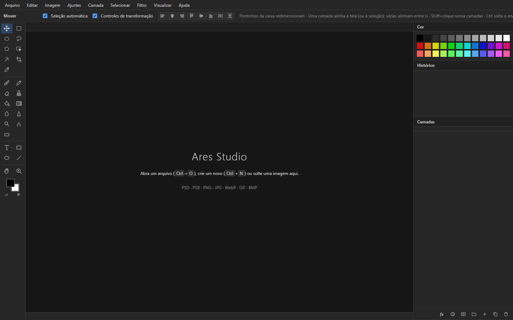

<p align="center">
  
</p>

<h1 align="center">Ares Studio</h1>

<p align="center">
  <b>Editor de imagens no estilo Photoshop, que abre e salva PSD de verdade.</b><br>
  App de mesa para Windows, offline, com camadas, máscaras, ajustes, estilos de camada e mais de 50 filtros.
</p>

<p align="center">
  
  
  
  
  
</p>

<p align="center">
  
</p>

---

## 🧠 Como funciona

O Ares Studio é uma janela própria do Windows (pywebview) com dois editores dentro:

| Editor | O que é | Como abrir |
|---|---|---|
| 🚀 **Principal** | Motor do [PhotoCraft](https://github.com/storytold/photocraft) 0.7.0 compilado para WebAssembly, com composição na placa de vídeo (WebGPU), em português e com a identidade do Ares Studio | `pythonw app.py` |
| 🕰️ **Clássico** | Editor feito à mão em HTML/JS puro, com leitura e gravação de PSD pelo [ag-psd](https://github.com/Agamnentzar/ag-psd) | `pythonw app.py --classico` |

## ✨ O que tem

- 📂 **Arquivos** — abre PSD, PSB, PNG, JPG, WebP, GIF e BMP · salva PSD · exporta PNG/JPG/WebP · várias abas · abrir recente
- 🧱 **Camadas** — grupos, opacidade, 27 modos de mesclagem, máscara de camada, máscara de corte, bloqueios, várias camadas selecionadas, alinhar e distribuir
- 🎚️ **Camadas de ajuste não destrutivas** — brilho/contraste, níveis, curvas, exposição, vibratilidade, matiz/saturação, equilíbrio de cores, preto e branco, filtro de fotos, misturador de canais e mais
- 🎨 **Estilos de camada** — sombra projetada e interna, traçado, brilho externo e interno, acetinado, sobreposição de cor e de degradê (gravam no PSD)
- 🛠️ **Ferramentas** — mover, letreiros, laços, varinha, seleção de objeto, corte com alças, pincel, lápis, borracha, carimbo, lata de tinta, degradê, texto, formas, desfoque, nitidez, subexposição, superexposição, esponja, mão e zoom
- ✨ **54 filtros** — desfoques (movimento, radial, tilt-shift, íris…), nitidez, ruído, distorções (redemoinho, esferizar, onda, coordenadas polares…), pixelização, estilização (pintura a óleo, vento, solarizar…), nuvens, reflexo de lente e vinheta
- 📏 **Precisão** — réguas, guias com encaixe, transformação livre (Ctrl+T), seletor de cores completo (HSB/RGB/hex), histórico de 40 passos
- 🎞️ **Movimento** — zoom animado, deslize com inércia, zoom de arrasto, atalhos parecidos com os do Photoshop

## 🛠️ Rodar

```bash
pip install pywebview pywin32
pythonw app.py                 # editor principal
pythonw app.py arquivo.psd     # já abre um arquivo
pythonw app.py --classico      # editor clássico
python  app.py --autoteste     # confere se o motor subiu na janela real
```

## 🗂️ Estrutura

```
app.py            janela, servidor local e identidade própria na barra de tarefas
motor/            motor do PhotoCraft em WebAssembly (entrada: motor/ares.html) + licenças
web/              editor clássico
  js/core.js        camadas, composição e histórico
  js/tools.js       ferramentas
  js/filters.js     ajustes e filtros
  js/craft.js       filtros e ajustes recriados a partir do PhotoCraft
  js/psd.js         abrir e salvar PSD
  js/ui.js · ops.js interface e menus
  vendor/           ag-psd e avisos de licença
fazer_icone.py    desenha a logo (web/icone.ico e web/icone.png)
```

## 🙏 Créditos

- [**PhotoCraft**](https://github.com/storytold/photocraft) — ArtCraft Team e contribuidores do PhotoCraft, sob MIT ou Apache-2.0. O motor em `motor/` é a versão web oficial deles, e o `web/js/craft.js` adapta algoritmos do código em Rust. Licenças em `motor/LICENSE-MIT`, `motor/LICENSE-APACHE` e `web/vendor/photocraft-NOTICE.txt`.
- [**ag-psd**](https://github.com/Agamnentzar/ag-psd) — leitura e gravação de PSD, licença MIT (`web/vendor/ag-psd-LICENSE.txt`).

Photoshop é marca da Adobe. Este projeto não tem ligação com a Adobe.

## 📜 Licença

Código do Ares Studio sob [MIT](LICENSE) © 2026 Gusthavo Silva. O motor em `motor/`, o `web/js/craft.js` e o ag-psd mantêm as licenças originais listadas em Créditos.

---

<p align="center">Feito por <a href="https://github.com/Gusthavx">Gusthavo Silva</a></p>
